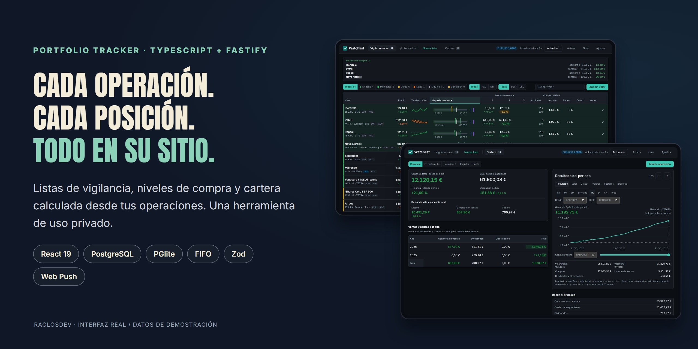
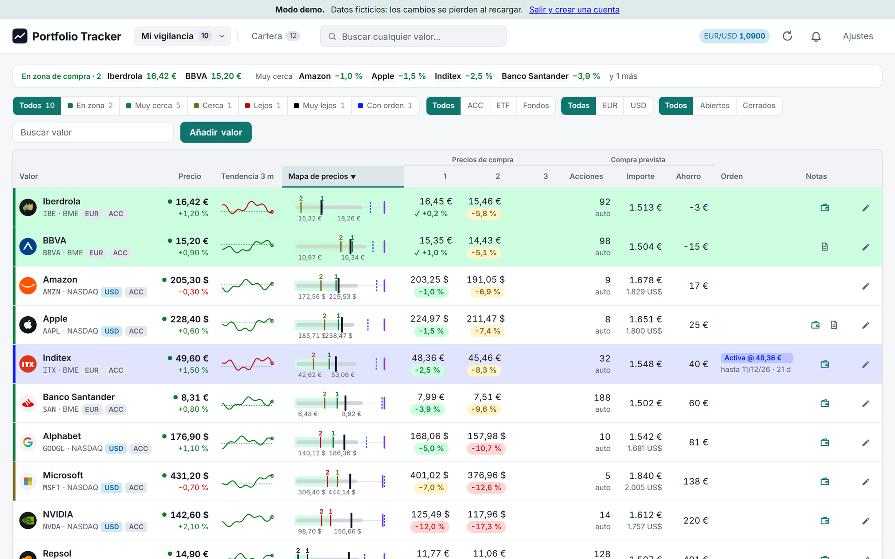
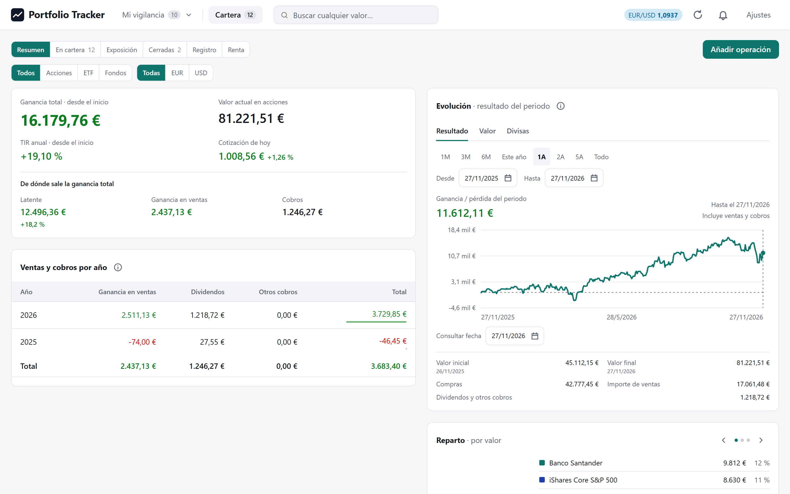
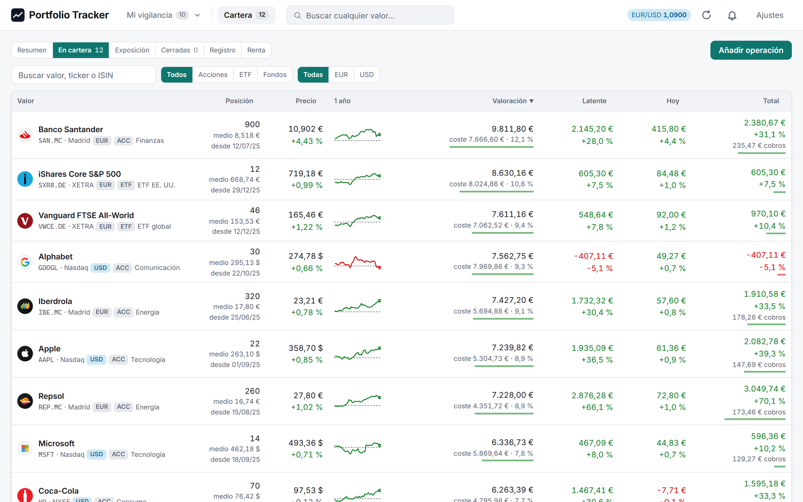
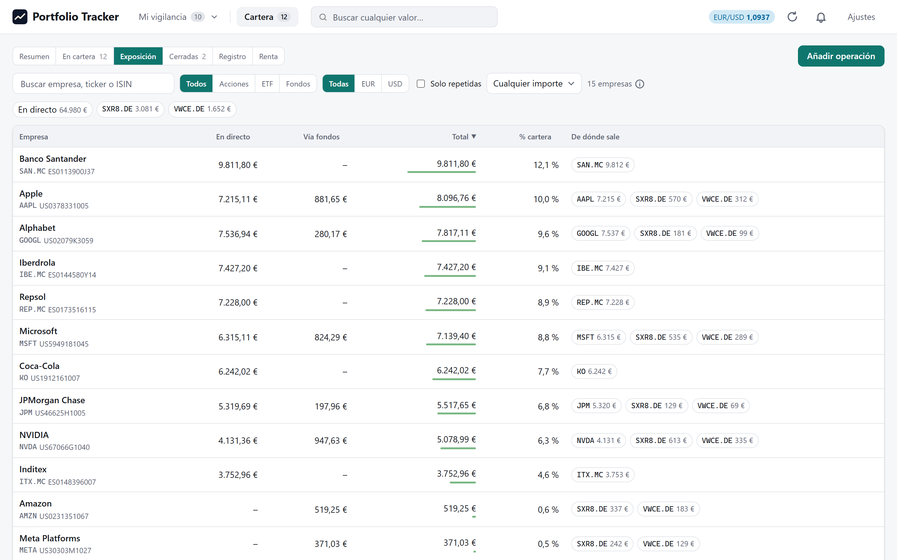
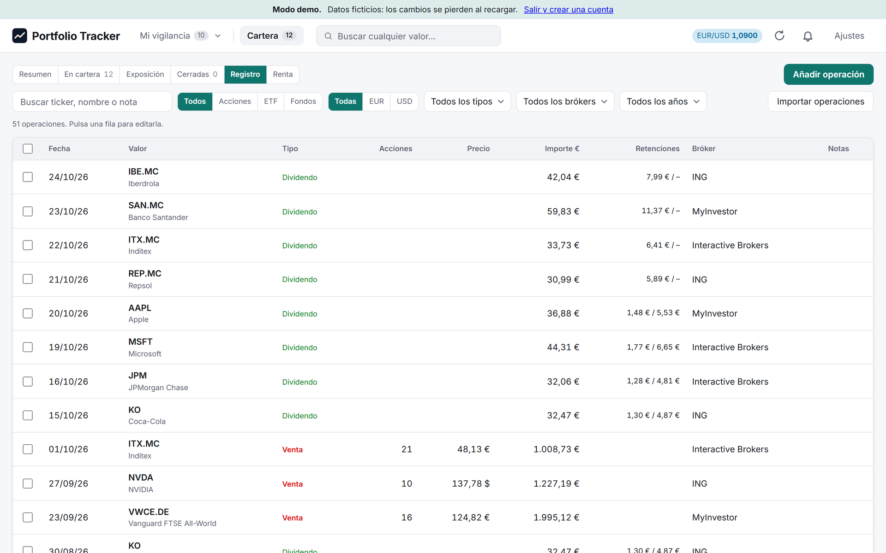

# Portfolio Tracker

**Seguimiento de inversiones, desde una lista de vigilancia hasta el registro de operaciones.** Una aplicación personal para ver niveles de compra, ordenar una cartera y consultar cómo se calcula cada posición.



[](https://github.com/RaclosDev/portfolio-tracker/actions/workflows/ci.yml) [](https://github.com/RaclosDev/portfolio-tracker/actions/workflows/codeql.yml) [](LICENSE)

[Arquitectura](docs/arquitectura.md) · [Instalación y uso](docs/guia.md) · [Capturas reproducibles](docs/screenshots/README.md) · [Abrir Portfolio Tracker](https://cartera.raclos.es) · [Demo con datos ficticios](https://cartera.raclos.es/demo)

## Qué resuelve

- **Vigilar acciones, ETF y fondos:** listas, búsqueda por nombre, ticker o ISIN, hasta tres niveles de compra y distancia al precio actual. Los importes contemplan la conversión de divisa.
- **Entender la cartera:** posiciones, reparto por valor, sector y bróker, rentabilidad y posiciones cerradas, calculados a partir de compras, ventas y otras operaciones.
- **Mantener un registro:** dividendos, scrip, derechos, splits y traspasos entre fondos; importación de Excel/CSV con revisión de columnas, vista previa y detección de posibles duplicados. El cálculo de lotes utiliza FIFO y permite exportar informes.
- **Recibir avisos:** notificaciones push de niveles y órdenes registradas, con un resumen diario. La aplicación hace seguimiento; no envía operaciones a un bróker.
- **Usarla en cualquier pantalla:** PWA instalable con tema claro y oscuro, y vista compacta en el móvil.
- **Conservar los datos:** copias diarias y una copia antes de importar, con exportación y restauración desde la interfaz.

## Un recorrido por la aplicación

<table>
  <tr>
    <td align="center" width="50%"><picture><source media="(prefers-color-scheme: dark)" srcset="docs/screenshots/watchlist-dark.png"></picture><br><sub><b>Lista de vigilancia</b> · niveles de compra y distancia</sub></td>
    <td align="center" width="50%"><picture><source media="(prefers-color-scheme: dark)" srcset="docs/screenshots/portfolio-dark.png"></picture><br><sub><b>Cartera</b> · evolución, rentabilidad y totales</sub></td>
  </tr>
  <tr>
    <td align="center"><picture><source media="(prefers-color-scheme: dark)" srcset="docs/screenshots/positions-dark.png"></picture><br><sub><b>Posiciones</b> · precio medio, valor y resultado</sub></td>
    <td align="center"><picture><source media="(prefers-color-scheme: dark)" srcset="docs/screenshots/exposure-dark.png"></picture><br><sub><b>Exposición</b> · empresa a empresa, fondos y ETF incluidos</sub></td>
  </tr>
  <tr>
    <td align="center" colspan="2"><picture><source media="(prefers-color-scheme: dark)" srcset="docs/screenshots/operations-dark.png"></picture><br><sub><b>Registro</b> · compras, ventas y dividendos</sub></td>
  </tr>
</table>

Capturas de la interfaz real en escritorio, tomadas de la [demo pública](https://cartera.raclos.es/demo) en noviembre de 2026; se muestran en claro u oscuro según el tema de GitHub. Los datos son ficticios y reproducibles: no representan una cuenta, cotizaciones actuales ni resultados de inversión. Cada usuario dispone de listas, cartera y ajustes privados.

## Decisiones técnicas que puedes revisar

| Problema | Implementación | Dónde verlo |
| --- | --- | --- |
| Reconstruir posiciones desde operaciones | Cálculo de lotes FIFO separado de la presentación, con pruebas de dominio | [`Ledger.java`](backend/src/main/java/com/cartera/service/portfolio/Ledger.java) |
| Trabajar con datos de mercado externos | Varias fuentes en cadena tras una misma interfaz, con caché y pausa propia ante límites de consultas | [`service/market`](backend/src/main/java/com/cartera/service/market) |
| Recuperar una cartera tras una importación | Copias automáticas y servicio de restauración | [`BackupService.java`](backend/src/main/java/com/cartera/service/backup/BackupService.java) |
| Separar los datos de cada usuario | Correo y contraseña o Google, JWT de corta duración con refresco rotatorio en cookie y cada fila ligada a su cuenta | [`service/auth`](backend/src/main/java/com/cartera/service/auth), [`config`](backend/src/main/java/com/cartera/config) |
| Evolucionar la base de datos sin perder datos | Migraciones Flyway versionadas; la V2 importa los datos de la versión anterior | [`db/migration`](backend/src/main/resources/db/migration) |
| Probar contra la base de datos real | Tests de integración con PostgreSQL en Testcontainers y mínimo de cobertura con JaCoCo | [`backend/src/test`](backend/src/test/java/com/cartera) |

**Stack:** Java 21 · Spring Boot 4 · Spring Security · Spring Data JPA · Flyway · PostgreSQL · React 19 · TanStack Query · Vite · Vitest · JUnit 5 · Testcontainers · Docker · GitHub Actions.

## Desarrollo local

Requiere Java 21, Node.js 22 y Docker.

```bash
docker compose up -d              # PostgreSQL en localhost:5434
cd backend && ./mvnw spring-boot:run   # API en http://localhost:8080
cd frontend && npm ci && npm run dev   # web en http://localhost:5173 (/api va a la API)
```

La [guía de configuración](docs/guia.md) explica autenticación, notificaciones, copias y despliegue. Para comprobar los cambios:

```bash
cd backend && ./mvnw verify       # tests (PostgreSQL en Docker) y cobertura
cd frontend && npm run lint && npm test && npm run build
docker build -t cartera .         # la imagen de producción: web + API
```

La [CI](.github/workflows/ci.yml) pasa lint, tipos, tests de la web y de la API y construye la imagen antes de desplegar; CodeQL analiza el código y Dependabot propone actualizaciones semanales. Las cotizaciones externas pueden tener retraso; la aplicación organiza información y no ofrece asesoramiento de inversión.

## Fuentes de cotización

Se consultan Financial Hub y Yahoo Finance y, para los valores sin precio y con cobertura alternativa, Borsa Italiana / FIDA, Quefondos / VDOS, onvista (bolsas alemanas como Xetra o Tradegate), justETF (ETF por ISIN, en euros) y FT Markets, en ese orden. El buscador por nombre combina los catálogos de onvista y Euronext. Si ninguna responde, se muestra el último precio guardado como tal. Cada proveedor tiene su propia pausa ante límites de consultas.

### Composición de fondos y ETF

La pestaña **Exposición** y la ficha de cada fondo usan su composición. La fuente principal es la API pública de [Financial Hub](https://api.financial-hub.es/docs) (datos de Morningstar, sin clave): con el ISIN encuentra el fondo y da su cartera completa (hasta 2.000 posiciones; la liquidez, las divisas a plazo y los derivados quedan como «sin desglosar»). Si no lo tiene o falla, se prueban extraETF y onvista (por ISIN), FT Markets (fondos y ETF, incluidos los españoles) y Yahoo Finance (por su ticker), que solo dan las 10 mayores posiciones; vale la primera que responde con datos coherentes. La composición se guarda una semana y, si todas las fuentes fallan, se muestra la última conocida.

Borsa aporta el último valor liquidativo de fondos, con su fecha e ISIN; no proporciona una serie histórica desde esa ficha. Se puede buscar el nombre de la clase en «Cotización automática» y elegir el resultado de Borsa. Los identificadores `BORSA:2FADB…` se guardan sin necesitar claves de API. Como su buscador no indexa todos los ISIN, los vínculos verificados por ISIN están en `BorsaProvider.java` y se comprueban contra la ficha en cada actualización. No hay cobertura universal ni conversión automática entre clases de un fondo.

Quefondos permite buscar fondos por su ISIN y aporta NAV fechado y observaciones mensuales para los gráficos individuales, sin clave de API. Los tickers de Yahoo con correspondencia verificada están en `QuefondosProvider.java`; cada ficha debe coincidir con su ISIN y divisa. Sus datos mensuales no sustituyen los cierres diarios del resumen: si un valor carece de histórico diario, se muestra una curva parcial de los valores disponibles, excluyendo también todas las operaciones de los omitidos y avisando de ello.

Para añadir una fuente, se implementa `MarketDataProvider` y se añade, en su orden, a la lista de `FallbackProvider` en [`MarketConfig.java`](backend/src/main/java/com/cartera/service/market/MarketConfig.java). Una fuente solo cubre los símbolos que puede identificar con seguridad; una respuesta vacía permite probar la siguiente.
