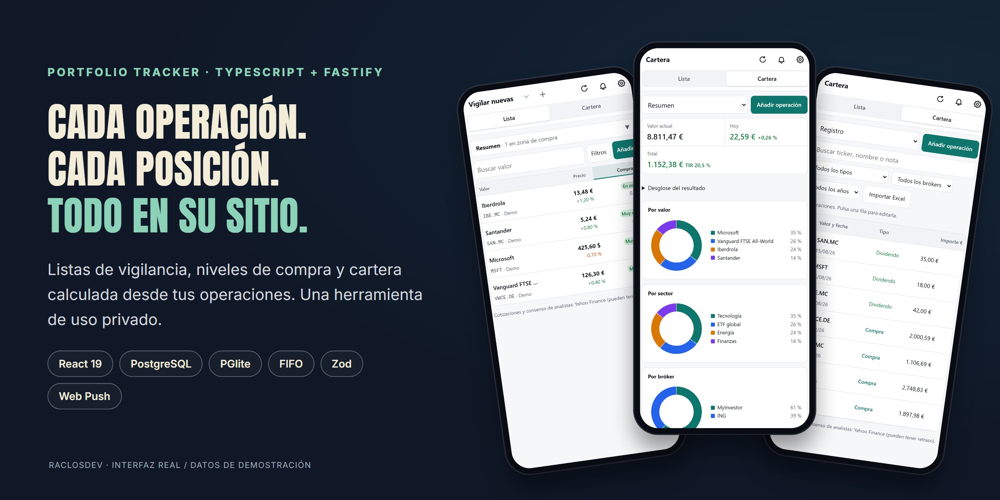
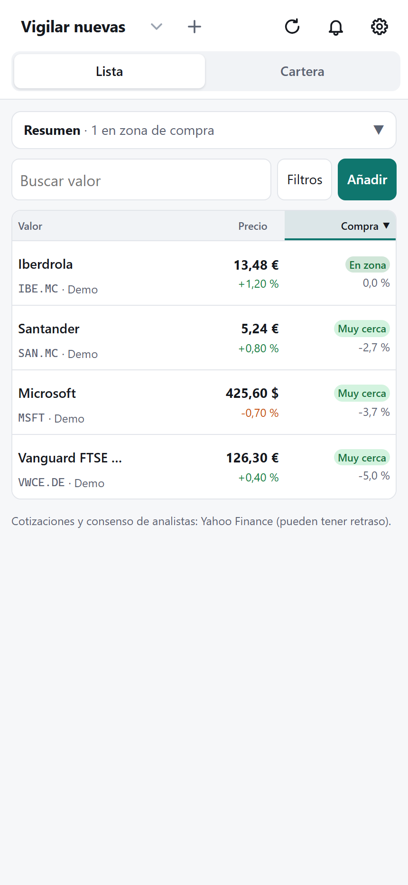
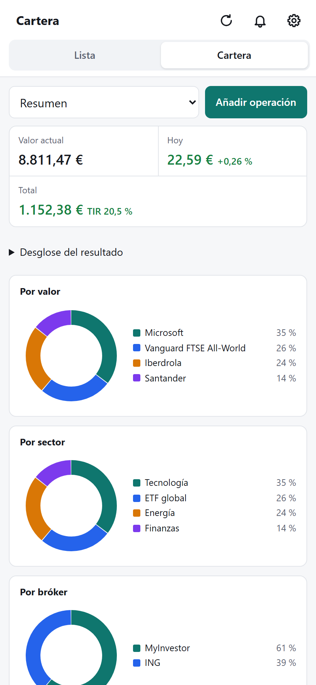
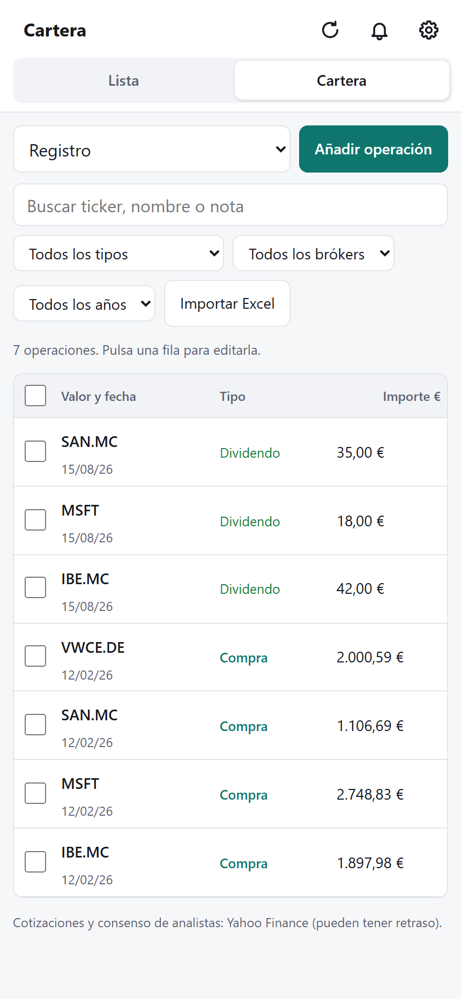

# Portfolio Tracker

**Seguimiento de inversiones, desde una lista de vigilancia hasta el registro de operaciones.** Una aplicación personal para ver niveles de compra, ordenar una cartera y consultar cómo se calcula cada posición.



[Arquitectura](docs/ARQUITECTURA.md) · [Instalación y uso](docs/GUIA.md) · [Capturas reproducibles](docs/screenshots/README.md) · [Abrir Watchlist](https://cartera.raclos.es)

## Qué resuelve

- **Vigilar acciones y ETF:** listas, búsqueda por nombre, ticker o ISIN, hasta tres niveles de compra y distancia al precio actual. Los importes contemplan la conversión de divisa.
- **Entender la cartera:** posiciones, reparto por valor, sector y bróker, rentabilidad y posiciones cerradas, calculados a partir de compras, ventas y otras operaciones.
- **Mantener un registro:** dividendos, scrip, derechos y splits; importación de Excel/CSV con revisión de columnas, vista previa y detección de posibles duplicados. El cálculo de lotes utiliza FIFO y permite exportar informes.
- **Recibir avisos:** notificaciones push de niveles y órdenes registradas, con un resumen diario. La aplicación hace seguimiento; no envía operaciones a un bróker.
- **Conservar los datos:** copias diarias y una copia antes de importar, con exportación y restauración desde la interfaz.

## Un recorrido por la aplicación

<table>
  <tr>
    <td align="center"><strong>Lista de vigilancia</strong></td>
    <td align="center"><strong>Resumen de cartera</strong></td>
    <td align="center"><strong>Registro de operaciones</strong></td>
  </tr>
  <tr>
    <td></td>
    <td></td>
    <td></td>
  </tr>
</table>

Capturas de la interfaz real con datos ficticios reproducibles. No representan una cuenta, cotizaciones actuales ni resultados de inversión. Cada usuario dispone de listas, cartera y ajustes privados.

## Decisiones técnicas que puedes revisar

| Problema | Implementación | Dónde verlo |
| --- | --- | --- |
| Compartir reglas entre API e interfaz | Monorepo TypeScript con esquemas Zod y funciones de cálculo compartidas | [`packages/shared`](packages/shared/src) |
| Reconstruir posiciones desde operaciones | Cálculo de lotes FIFO separado de la presentación, con pruebas de dominio | [`ledger.ts`](packages/shared/src/cartera/ledger.ts), [`ledger.test.ts`](packages/shared/src/cartera/ledger.test.ts) |
| Trabajar con datos de mercado externos | Proveedor aislado, caché y tratamiento de fallos en el servicio de mercado | [`modules/market`](apps/server/src/modules/market) |
| Recuperar una cartera tras una importación | Copias automáticas y servicio de restauración | [`backup.service.ts`](apps/server/src/modules/backup/backup.service.ts) |
| Separar los datos de cada usuario | Registro con correo y contraseña o Google, sesiones revocables y un esquema de datos por cuenta | [`modules/auth`](apps/server/src/modules/auth) |
| Desarrollar sin instalar un servidor de base de datos | PostgreSQL en producción y PGlite en desarrollo y pruebas | [`database.ts`](apps/server/src/db/database.ts) |

**Stack:** Node.js · TypeScript · Fastify 5 · React 19 · TanStack Query · Vite · PostgreSQL / PGlite · Vitest · GitHub Actions.

## Desarrollo local

Requiere Node.js 22.13 o superior.

```bash
npm ci
npm run dev
```

La web arranca en `http://localhost:5173` y la API en `http://localhost:5174`. Sin `DATABASE_URL`, se utiliza PGlite local. La [guía de configuración](docs/GUIA.md) explica autenticación, notificaciones, copias y despliegue.

```bash
npm test
npm run typecheck
npm run build
```

La [CI](.github/workflows/desplegar.yml) comprueba tipos, pruebas y compilación antes del despliegue. Las cotizaciones externas pueden tener retraso; la aplicación organiza información y no ofrece asesoramiento de inversión.
